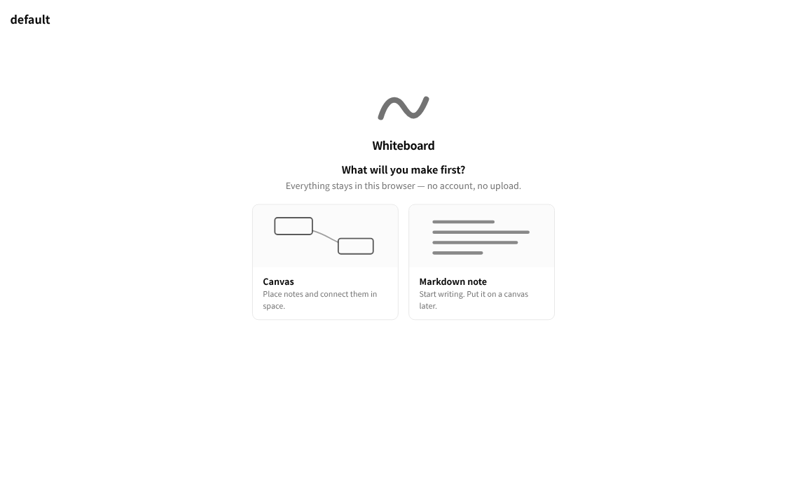
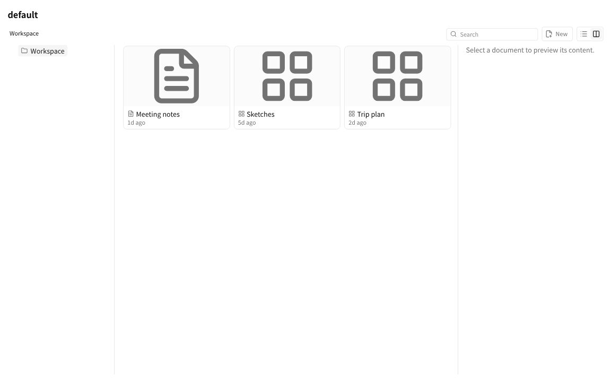

# Getting started

whiteboard's canvas runs right in your browser. When the **browser** is the
keeper, your
drawings live in your own browser (IndexedDB) — no account, and nothing leaves
your machine while you work.

Today you run the browser app locally from a checkout. **Prerequisites:** Node.js
and pnpm (run `corepack enable` if you don't already have pnpm).

```bash
git clone https://github.com/kamiazya/whiteboard.git
cd whiteboard      # pnpm workspace root — required for catalog: dependency resolution
pnpm install
pnpm --filter @kamiazya/whiteboard-web dev   # open http://localhost:5173
```

On a fresh browser the page asks what you'll make first — pick **Canvas**
(notes you place and connect in space) or **Markdown note** (start writing;
you can put it on a canvas later) and it opens ready to work in.



Once you have documents, the page lands on your document browser. On a
touch screen, tap a card to open the document, and tap its **…** button (or press
and hold the card) for its actions (open, pin, rename, delete). With a mouse, a click previews a
document in the pane beside the list, and a double-click — or Enter on a
focused one — opens it. That holds for the cards, the **Recent** strip and
search results alike. Each card shows a small picture of its document — a
note's picture is cropped to the text it holds — and a document with nothing
in it yet shows its kind with **Empty** under it. Search keeps your query in the box when you open a
result and come back. A **Recent** strip above the cards lists the documents you
opened last — however you opened them: a card, a link, a reload, search or
**Create** — and appears only once there are more documents than fit in the
first row of cards — before that it would show every card twice. On a phone
or a narrow window the strip is left out altogether, since the list is right below. Use the
toolbar to search everything or move a document to a new path; to put a
document in a folder, use **Move to folder…** in its menu or drag it onto the
folder ([organize into folders](../how-to/organize-into-folders.md)). **Back to
documents** returns you to the folder the document was in.

**New** in that toolbar opens the same two choices — **Canvas** or **Markdown
note** — and creates one in whichever folder you are standing in. A kind
cannot be changed later, which is why you pick it by name rather than by
icon; everything else about a document is editable afterwards, so nothing
else is asked for. A new document starts at the path `untitled`, and until it
has a name the lists call it **Untitled** (**Untitled 2** for `untitled-2`), the
word its title box shows; the first time
you give it a name in its title, its path becomes that name (`untitled` to
`checkout-architecture`), and from then on the path stays put. If you already know what the document is called and where
it goes, **Name and folder…** in that menu takes both up front; leaving its
form untouched creates exactly what the plain entries would have.

On a phone, or any touch screen, **New** opens a sheet from the bottom edge
instead. Its first field is the name, with the keyboard already up; type it and
press **Canvas** or **Markdown note**, and the document is created under that
name at the path the name earns (`Meeting notes` becomes `meeting-notes`).
Leave the name empty and it starts at `untitled` as above.

Either way the new document opens straight away, ready to work in. The folder
you are standing in is part of the address — the URL carries a `?folder=`
while you are inside one — so coming back lands you where you were, a reload
keeps your place, and a link you paste to someone opens the folder you meant.
The column layout is not in the link: that is a per-browser preference, so
your choice is remembered here without being imposed on whoever you send it
to.



A fresh canvas starts empty, with a one-line hint ("Double-click to add a note", or "Tap + to add a note" on a touch screen) that disappears with the first node. Double-click empty canvas space to make a note
and start typing immediately (this works in Hand mode too, and never moves the
view), or open the **+** menu in the bottom dock: tap
an entry to place it in the middle of the view, or drag one onto the canvas
to drop it exactly where you want it. **Group** frames what is selected; with
nothing selected it makes an empty frame in a free spot and opens its name for
typing, and an empty frame is drawn with a faint tint so it can be found. In **Select** mode, right-clicking
(long-pressing on touch) empty space offers the same creations, placed where
you pressed. On touch the menu is a sheet titled for what you pressed, dimmed behind, at most half the screen (it scrolls), and the canvas pans so the pressed object stays visible above it; tap the dimmed area to close it. Hand mode is navigation only, so it deliberately leaves the
right-click menu closed (a tap on a comment still opens its conversation:
comments are chrome, not content). The
browser UI also selects, moves, resizes, connects, and edits existing nodes,
and deletes the selected node with Delete/Backspace (disabled while you're
typing in its text editor, so Backspace edits text instead of deleting the
note). Reload the tab after any of these edits and the change is still
there — that's your canvas persisting to IndexedDB in your own browser, with
no server and no account.

A small status beside the document title tells you whether your edits are safe.
It reads **Saved** (quietly) once the last change has landed, **Saving…** if a
write takes longer than a moment, **Not saved — storage problem** when the
browser refuses a write or no write lands for several seconds while a change
waits to be saved, and **Offline — changes kept here** when a document
kept by the daemon cannot reach it: your edits stay in this browser and are sent
when the connection returns. On a phone it shrinks to an icon; hover or long-press
for the words. A problem is shown, and a screen reader told, only once it has
lasted a moment — one that clears by itself is never announced — and never on an
ordinary save.

**Where to go next:** want your AI agent (Claude Code, Codex, Gemini) to draw with
you, or durable canvases as files on disk? That's the **Local daemon** — see
[Quick install](../../README.md#quick-install). Curious how whiteboard scales from a
browser tab to a self-hosted team server? See [the runtime modes](../explanation/).

← Back to [documentation home](../)
